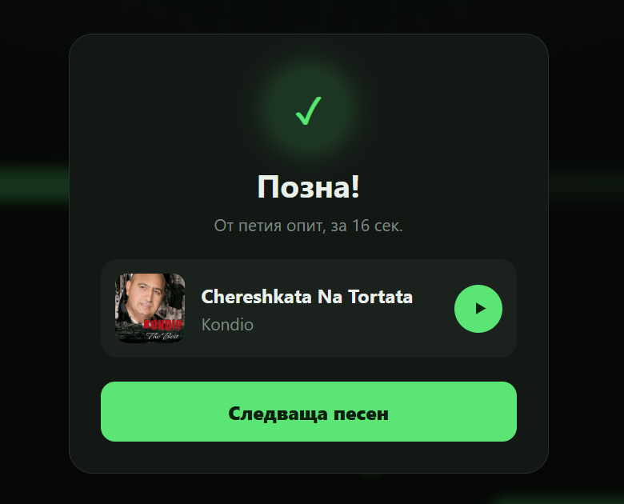
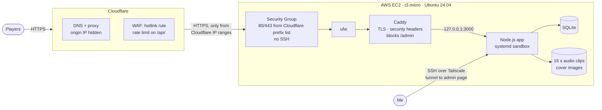
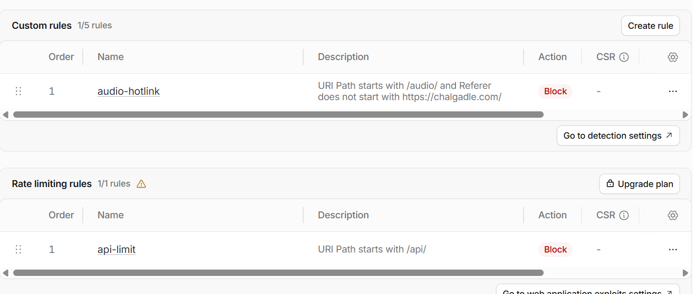

# chalgadle

**A "guess the song" game for Bulgarian music, self-hosted on AWS and hardened step by step.**

🎵 Live: [chalgadle.com](https://chalgadle.com) · 🗓️ Built 13–18 October 2026 (first public beta) · 👤 [Aleksandar Gotev](https://github.com/AlexanderGotev)

<p align="center"></p>

## What it is

Song-guessing games such as Heardle and Songspot exist for English-language music, but nothing similar existed for Bulgarian pop-folk (*chalga*), hip-hop and pop. My friends and I wanted to play one, so I built it.

You hear **0.1 seconds** of a song. Every wrong guess or skip unlocks more: 0.5 → 2 → 8 → 16 seconds. The library has about **3,200 songs** across two genres.

The game itself was the starting point. **The main focus of this repository is the infrastructure and security work around it:** taking a small Node.js app from "runs on my laptop" to a public service on a cloud VM, then reducing its attack surface layer by layer and verifying each layer.

## Architecture



More detail: [docs/architecture.md](docs/architecture.md).

## Security at a glance

Each measure is documented in [docs/security.md](docs/security.md) as **risk → what I did → how I verified it**.

| Layer | Measure |
|---|---|
| Network | Origin IP hidden behind Cloudflare; Security Group accepts web traffic **only from Cloudflare's IP ranges** (managed prefix list); no public SSH |
| Access | SSH only over a private Tailscale network, key-only, root login disabled; fail2ban |
| Edge | Cloudflare rate limiting on the API, WAF rule against audio hotlinking, Full (strict) TLS |
| Web server | Caddy with automatic HTTPS, HSTS, enforced Content-Security-Policy, X-Frame-Options and other headers; server fingerprints removed |
| Admin panel | Two independent layers: Caddy returns 404 from outside, and the app rejects anything that came through a proxy |
| Application | Answer kept server-side (round tokens, 5 attempts per round), no path traversal, parameterised SQL, escaped HTML, body size limits |
| Process | systemd sandbox: no privilege escalation, read-only filesystem except data folders, no access to SSH keys or API tokens. `systemd-analyze security` exposure **9.2 → 6.9** |
| Host | Automatic security updates with scheduled reboot, IMDSv2 required, ufw firewall |
| Data | Nightly SQLite backups (14 days kept), copied off the server |

<p align="center"></p>

## Tech stack

- **App:** Node.js 22 with only built-in modules (`http`, `node:sqlite`). No npm dependencies, so there is no third-party package supply chain to keep track of.
- **Frontend:** plain HTML/CSS/JavaScript and the Web Audio API.
- **Audio analysis:** an in-browser algorithm that picks where each clip starts (loudness, harmonic self-similarity to find the chorus, then a start point in the verse before it).
- **Infrastructure:** AWS EC2, Cloudflare (DNS, proxy, WAF), Caddy, systemd, ufw, Tailscale, ffmpeg.

## Repository layout

```
app/        the game: Node.js server, frontend, admin panel, maintenance scripts
config/     server configuration as deployed (Caddyfile, systemd units, cron scripts)
docs/       architecture, security, operations, design decisions, roadmap
```

| Document | Contents |
|---|---|
| [architecture.md](docs/architecture.md) | Request flow, components, how the game and the clip-start algorithm work |
| [security.md](docs/security.md) | Every hardening step with the risk, the change and the verification |
| [operations.md](docs/operations.md) | Deploying from scratch, updates, backups, maintenance scripts |
| [decisions.md](docs/decisions.md) | Why Tailscale and not SSM, why a prefix list, and the trade-offs I accepted |
| [roadmap.md](docs/roadmap.md) | Known limitations and what comes next |

## What I learned

- **Defence in depth works best when each layer is verified separately.** For example, I tested the admin protection with the Caddy rule present *and* as if it had been removed. That test showed my first application-level check was useless behind a reverse proxy, because every request arrives from `127.0.0.1`.
- **The cloud provider's firewall and the host firewall answer different questions.** The Security Group decides who can reach the machine at all, while ufw is a second line if that configuration is ever wrong.
- **Hiding something is not the same as protecting it.** Putting the site behind Cloudflare hides the IP, but only restricting the Security Group to Cloudflare's ranges makes the hiding meaningful.
- **Not every risk is worth solving.** I skipped some measures on purpose (GuardDuty, a separate IAM user) and wrote down why in [decisions.md](docs/decisions.md).

## Notes

- **Code comments and UI are in Bulgarian**, since the game is for Bulgarian players. The documentation is in English.
- **Audio files, the database and cover images are not part of this repository.** All songs belong to their respective rights holders.

## License

[MIT](LICENSE) © 2026 Aleksandar Gotev
