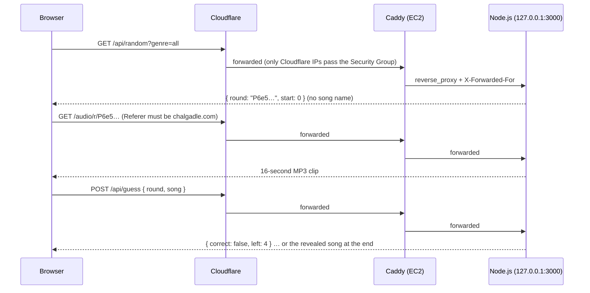
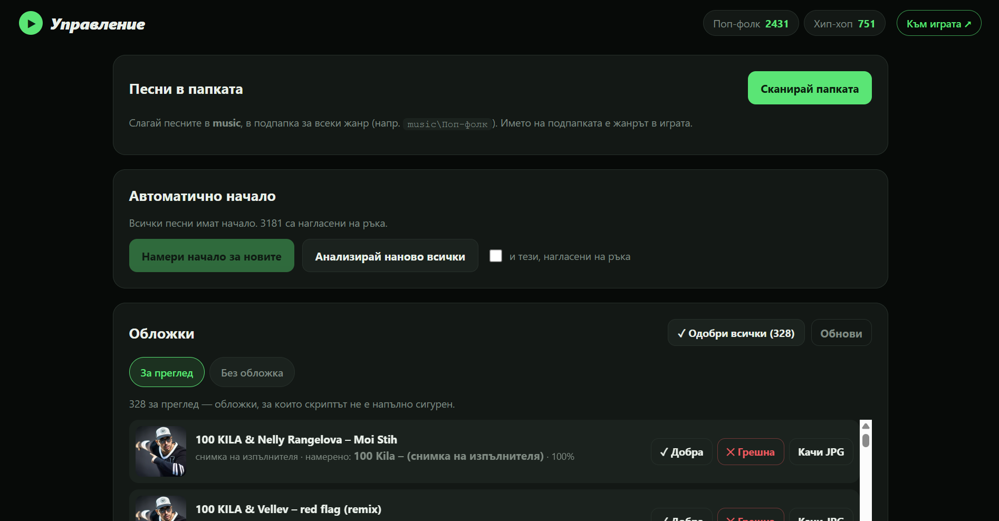

# Architecture

## Request flow



## Components

| Component | Role |
|---|---|
| **Cloudflare** | Authoritative DNS, reverse proxy (hides the origin IP), TLS at the edge, WAF custom rule, rate limiting, caching of static files and cover images |
| **AWS EC2** | `t3.micro`, Ubuntu 24.04 LTS, region `eu-north-1`. One Security Group and no Elastic IP: a DDNS script keeps the Cloudflare record up to date |
| **Caddy** | Terminates TLS with an automatically renewed Let's Encrypt certificate, adds security headers, blocks admin paths, proxies everything else to Node |
| **Node.js app** | HTTP server built with Node's standard library only. Serves the game, the API, audio clips and cover images. Runs as a hardened systemd service |
| **SQLite** | `data/library.db`, through the built-in `node:sqlite` module. One table, `songs` |
| **Tailscale** | Private network between my laptops and the server. The only way to reach SSH, and through it the admin panel |

Configuration files for all of these are in [`config/`](../config).

## The application

```
app/
├── server.js          HTTP server, routing, access control, rounds, audio streaming, covers
├── db.js              SQLite schema and prepared statements
├── library.js         scans the music folder, reads ID3 tags (incl. Windows-1251), detects duplicates
├── fetch_covers.js    finds cover art on Deezer / iTunes and stores it as data/covers/<id>.jpg
├── finalize_clips.js  cuts every song down to the 16.5-second clip used by the game (ffmpeg)
├── cleanup.js         removes duplicate and live recordings from the library
└── public/
    ├── index.html, app.js, player.js, style.css      the game
    ├── admin.html, admin.js, admin.css               the admin panel
    ├── admin.covers.js                               cover review in the admin panel
    └── analyze.js, analyze-worker.js                 clip-start detection (runs in a Web Worker)
```

### Game round

1. `GET /api/random` picks a random song the player has not had yet. It returns only a random **round code** and the clip start, never the song's ID or name. The server keeps `code → song` in memory (TTL 6 h, capped at 50,000 rounds).
2. The browser downloads the clip from `/audio/r/<code>`, decodes it with the Web Audio API and plays exactly 0.1 / 0.5 / 2 / 8 / 16 seconds.
3. Every action (guess, skip, give up) is a `POST /api/guess`. The server answers only `correct` / `wrong`, counts the attempts, and reveals the song after a correct guess or the fifth attempt.
4. The result screen loads the cover from `/covers/<id>.jpg`. It is requested only at that point, so it cannot give away the answer during the round.

The search box autocompletes from `GET /api/songs` (artist, title, genre) and matches Cyrillic and Latin spellings, because Bulgarian song titles are often written either way.

### Choosing where each clip starts

If every clip started at 0:00, most rounds would be silence or a generic intro. `public/analyze.js` picks a better start point for each song in the admin panel:

1. **Loudness over time** shows where the song actually "comes in" after the intro.
2. **Chroma features and self-similarity** (with transposition) find the strong sections that repeat, which is almost always the chorus.
3. The start is placed in the verse, about 22 seconds after the song comes in or earlier if a chorus comes sooner, so the 16 seconds end **before** the first chorus (where the title is usually sung).
4. The point is snapped to a beat, so the clip does not begin in the middle of a word.

Each song takes about 0.3–0.7 seconds to analyse. Starts can be adjusted by hand in the admin panel's waveform editor. Once the starts were set, `finalize_clips.js` cut every file down to a 16.5-second clip from that point (see [decisions.md](decisions.md#cut-songs-down-to-clips)).

### Admin panel

Reachable only from the server itself, so in practice through an SSH tunnel over Tailscale (see [security.md](security.md#admin-panel)). It is used to:

- scan the `music/` folder and add new songs (genre = sub-folder);
- run and adjust the clip-start analysis;
- edit artist, title and genre, or hide songs;
- review cover art: approve, reject, or upload a replacement.

<p align="center"></p>

### Database

`songs`: `id`, `file`, `artist`, `title`, `genre`, `start`, `start_manual`, `auto_start`, `choruses` (JSON), `entry`, `duration`, `reason`, `size`, `hidden`, `created_at`.

Cover images live outside the database in `data/covers/<id>.jpg`, with `_report.json` recording where each one came from and whether it has been reviewed.
